# Timestamp the first speaker turn

[Mermaid chart](speaker-timestamps.mmd) · [Verification skill](../../.cursor/skills/verify-fscript-rendering/SKILL.md)



pstack's `/statechart` checked 22 states. `TimestampFromFirstSegment` fails in two steps. The first segment has no speaker label, so the renderer buffers its text without recording its start time. When the renderer flushes the turn, it prints the zero timestamp. The source fixture reproduced `00:00:00` for a segment starting at five seconds in the renderer from both reviewed revisions.

The model uses up to three nonblank segments with distinct positive timestamps. The chart omits steps that keep the same visible label, such as appending another segment to the current turn.

To regenerate, copy `Turns.tla` and `Turns.cfg` from the skill and `speaker-timestamps.view.mjs` from this directory into a scratch directory. Use pstack at `5866df557357d005b3c0c9d3da0d9e739b4bdde3` and TLC 1.7.4.

```sh
"$PSTACK_STATECHART" Turns.tla --view speaker-timestamps.view.mjs --out speaker-timestamps
```
